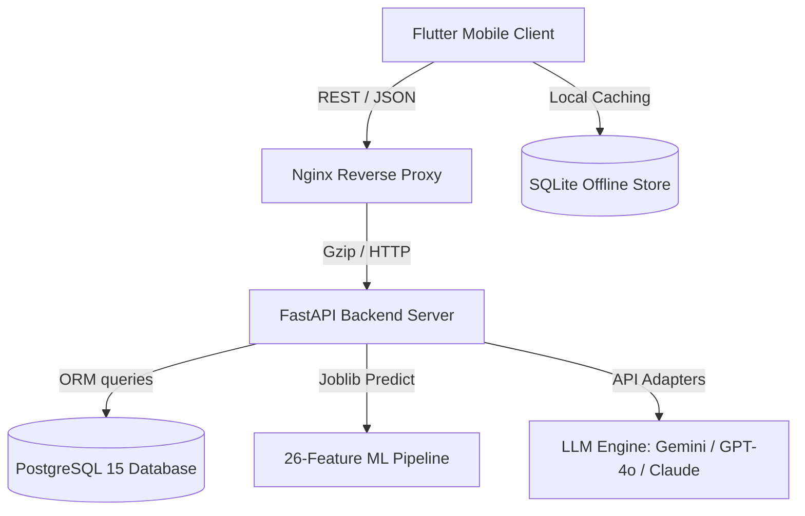
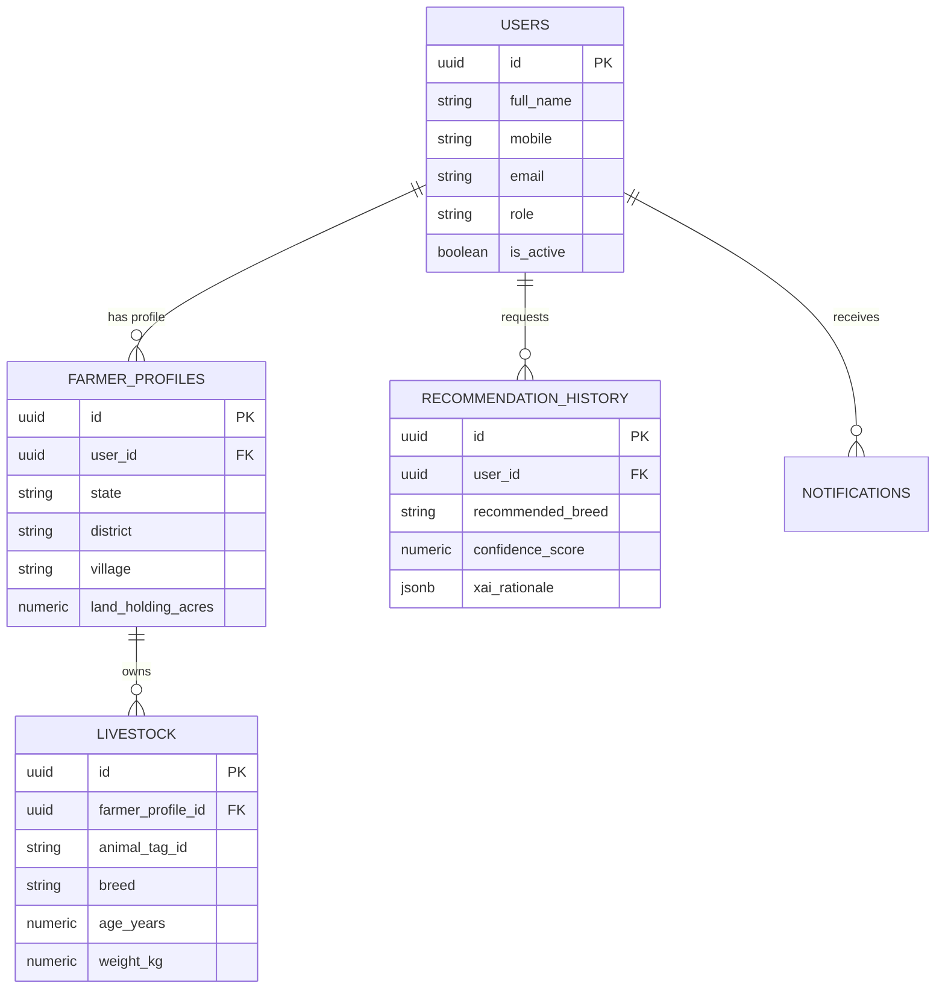
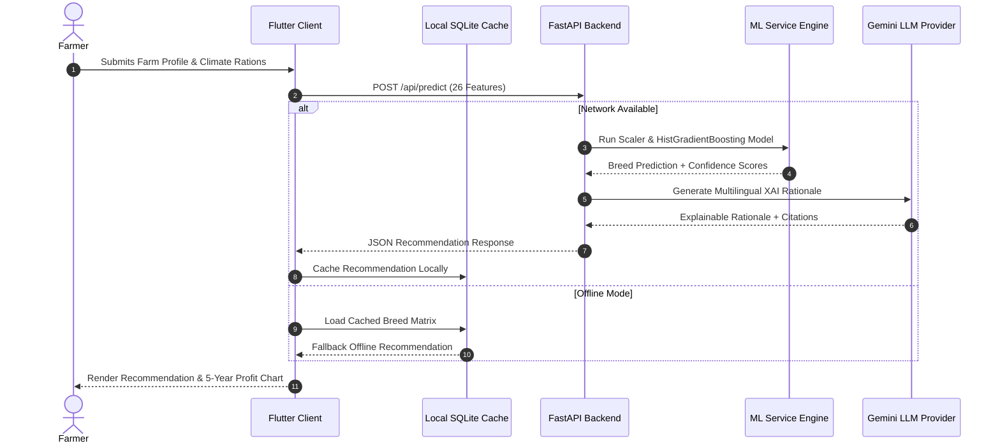
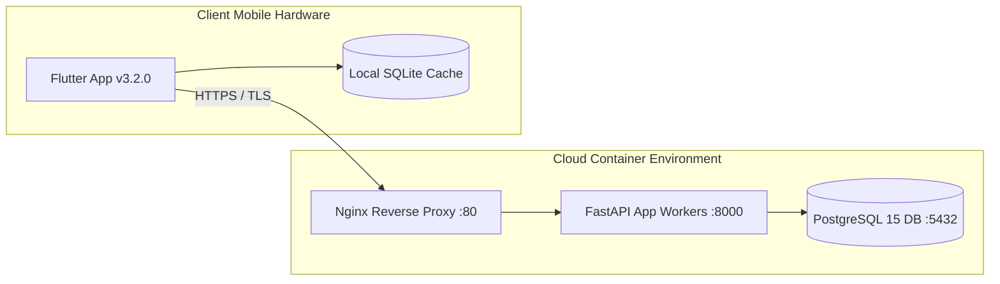

# Software Architecture Document (SAD)

## 1. Executive Summary

The **PasuMitra AI Indigenous Livestock Breed System** is built on an enterprise-grade Clean Architecture pattern separating domain entities, use-case interactors, presentation controllers, and remote/local data repositories.

---

## 2. System Architecture Diagram

---

## 3. Entity-Relationship (ER) Diagram

---

## 4. Sequence Diagram: AI Recommendation Request

---

## 5. Deployment Architecture Diagram

